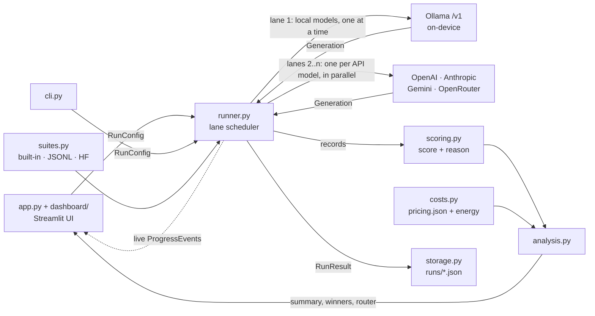

# Local SLM Benchmark & Cost Dashboard

Should this workload run on a small open-weights model on your own hardware, or is a commercial API worth the money?

This tool runs the same prompts on local models (via [Ollama](https://ollama.com)) and on OpenAI, Anthropic, and Google models. It puts speed, accuracy, and cost side by side, then gives a plain-English recommendation and a hybrid-routing plan.

Most teams start on a frontier API. A large share of traffic—classification, extraction, short summaries—can often be handled by a 3–8B model on a laptop or single GPU. The hard part is knowing which share. This dashboard measures time-to-first-token, latency, throughput, exact dollar cost, and graded accuracy on your prompts. It shows where local wins, where the API earns its price, and what a routing split would save. Local inference stays on-device.

## Screenshots

> **Placeholders.** Run the app in demo mode and capture these into `docs/screenshots/`.
>
> | File | What to capture |
> |---|---|
> | `docs/screenshots/overview.png` | Overview tab: winner cards, recommendation, accuracy-vs-cost scatter |
> | `docs/screenshots/results.png` | Results tab: summary table and side-by-side answer comparison |
> | `docs/screenshots/router.png` | Hybrid router tab: savings metrics and routing table |
> | `docs/screenshots/running.png` | Live progress while a benchmark runs |

<!-- After capturing, replace the block above with:

-->

## What it does

| | |
|---|---|
| **Model selection** | Any Ollama model you've pulled, plus OpenAI, Anthropic, Google Gemini, OpenRouter, or any OpenAI-compatible server (LM Studio, vLLM, llama.cpp). Compare up to 4 at once. |
| **Prompt sources** | Built-in 14-question suite (reasoning, knowledge, instruction-following, extraction, open-ended), a single pasted prompt, your own JSONL file, or a Hugging Face sample (GSM8K). |
| **Per-request metrics** | Time to first token, total latency, input/output tokens, decode tokens/sec, full response, exact API cost, and an electricity estimate for local runs. |
| **Accuracy** | 10 transparent scoring methods (numeric, exact, contains, JSON, IFEval-style format checks, keywords, fuzzy F1, optional LLM judge…). Every verdict has a one-line reason. |
| **Dashboard** | Winner cards (fastest, cheapest, most accurate, best value), recommendation text, accuracy-vs-cost scatter with Pareto frontier, latency breakdown, throughput, cost, per-category heatmap, side-by-side answers, CSV/JSON export. |
| **Hybrid router** | Picks the cheapest model that's "good enough" per task category and estimates blended accuracy, cost, and share of traffic kept on-device. Outputs a routing config. |
| **History** | Every run is saved as JSON in `runs/` and can be compared or reopened. Past runs re-price instantly when you edit prices. |
| **Privacy panel** | Shows exactly where each model's prompts go, live VRAM/RAM use of loaded Ollama models, and a trade-offs guide. |
| **Demo mode** | Clearly-labelled simulated models so anyone can explore the full dashboard in 10 seconds with zero setup. |

## Quick start

```bash
git clone <your-repo-url> local-slm-benchmark && cd local-slm-benchmark
python3.11 -m venv .venv && source .venv/bin/activate
pip install -r requirements.txt
streamlit run app.py
```

With nothing configured, the app opens in **demo mode**. Press **Run benchmark** to see every view populated with simulated results.

### Benchmark real local models

```bash
# 1. Install Ollama: https://ollama.com/download (macOS: brew install ollama)
ollama serve   # leave running (the desktop app does this for you)

# 2. Pull one or two small models
ollama pull llama3.2:3b   # ~2 GB
ollama pull qwen2.5:1.5b  # ~1 GB (or qwen2.5:7b, ~4.7 GB, if you have the disk and memory)
```

Refresh the dashboard, switch off demo mode, and your pulled models appear under **Local · Ollama**.

### Add API models

```bash
cp .env.example .env   # then fill in the keys you have
```

Or paste a key into the sidebar's **API keys** section for the current session only (it's never written to disk). Models from `config/pricing.json` appear for every provider with a key. Type `provider:model` to use anything not listed, e.g. `openrouter:meta-llama/llama-3.1-8b-instruct`.

### Headless / CI

```bash
python -m slmbench.cli models          # what's available
python -m slmbench.cli run -m ollama:llama3.2:3b -m openai:gpt-4o-mini
python -m slmbench.cli run --demo --prompts data/example_prompts.jsonl
```

## Results on my machine

Apple M2 Pro (16 GB unified memory) · Ollama 0.40.14 · 4-bit (Q4_K_M) weights · built-in 14-prompt suite × 3 repeats (84 requests, 0 errors) · temperature 0 · default system prompt · no judge model, so the two open-ended prompts are scored by keyword fallback.

```bash
python -m slmbench.cli run -m ollama:llama3.2:3b -m ollama:qwen2.5:1.5b --repeats 3
```

| Model          | Accuracy | TTFT p50 | Latency p50 | Latency p95 | Tokens/s | Cold start | GPU memory | Electricity / 1k requests |
| -------------- | -------: | -------: | ----------: | ----------: | -------: | ---------: | ---------: | ------------------------: |
| `llama3.2:3b`  |  **90%** |    0.03s |       0.14s |       1.40s |       44 |       2.5s |     2.6 GB |                   $0.0011 |
| `qwen2.5:1.5b` |      81% |    0.02s |   **0.08s** |       0.35s |   **93** |       1.6s |     1.2 GB |               **$0.0003** |

Electricity uses the default 60 W × $0.17/kWh, an upper bound (see the metrics table below).

| Category (prompts)        | `llama3.2:3b` | `qwen2.5:1.5b` |
| ------------------------- | ------------: | -------------: |
| Extraction (2)            |          100% |            67% |
| Instruction following (3) |           89% |           100% |
| Knowledge (3)             |          100% |           100% |
| Open-ended (2)            |          100% |            50% |
| Reasoning (4)             |           75% |            75% |

**What the misses were.** Every answer was identical across the three repeats, so these are stable failures, not noise:

- Llama answered the bat-and-ball puzzle with `110` (the ball costs 5¢) and listed the primary colors of light as "Red, Orange, Yellow".
- Qwen said 100 machines need `20` minutes to make 100 widgets (it's 5). Asked to extract a contact from *"…loop in Maria Chen (maria.chen@example.com)… Thanks, Dev"*, it returned the sign-off name and **invented** `dev@example.com`. That's the kind of confident wrong answer a format-only check would never catch.
- Qwen's open-ended answers got half credit for leaving out the key term the keyword fallback looks for ("wavelength", "self-hosted"). A judge model (`--judge`) would grade those more fairly.

**Small models are sensitive to the system prompt.** With no system prompt (`--system ""`), Qwen scored **86%** instead of 81%. The one-line default ("You are a helpful, concise assistant.") fixed its bat-and-ball answer but broke the widgets one and made its summaries terser. Llama's score didn't move. This is also why the CLI and the dashboard share one default: an earlier version used different ones and reported different accuracy for the same models.

**Hybrid router:** extraction and open-ended prompts to Llama, everything else to Qwen → **93% accuracy (vs 90% for Llama alone) at 37% lower electricity cost**. With 2–4 prompts per category, treat this as a hypothesis to validate on a larger set, not a result.

**Next run:** add an API model (`-m openai:gpt-4o-mini` costs under a tenth of a cent for this suite at these token counts) to measure how far these local models are from the hosted ceiling and what closing that gap costs. To see every dashboard view with API models without any keys, turn on **Demo mode**, which uses clearly labelled simulated models.

## How the numbers are measured

| Metric         | Definition |
| -------------- | ---------- |
| **TTFT**       | Wall time from sending the request to the first streamed token (content *or* reasoning). Includes network and prompt processing. |
| **Latency**    | Wall time until the stream closes. Reported as median (p50) and p95 across prompts. |
| **Tokens/sec** | Decode speed: Σ(output tokens − 1) ÷ Σ(latency − TTFT), weighted by tokens across requests. Averaging per-request rates would let one 2-token answer report thousands of tok/s. |
| **Tokens**     | Exact counts from the provider's usage report (`stream_options.include_usage`). If a server omits usage, counts are estimated at ~4 chars/token and flagged in the UI. |
| **API cost**   | `input_tokens × input price + output_tokens × output price`, from `config/pricing.json` (verified 2026-11-04). Reasoning models bill hidden thinking tokens as output, and those are included. |
| **Local cost** | `device watts × latency × $/kWh`. An upper bound: it attributes whole-system power to the request. |
| **Accuracy**   | Mean score (0–1 per prompt, partial credit for multi-check prompts) over successfully answered, scorable prompts. Failed requests are reported separately. |
| **Cold start** | Time to load a local model before timing begins (warm-up request, excluded from latency). |
| **Best value** | The cheapest model within *N* points (default 10) of the top accuracy. |

## Architecture & design decisions



The `slmbench/` package has no Streamlit dependency. The dashboard, the CLI, and the tests all call the same functions, so every surface reports identical numbers.

**1. One client, many providers.** Ollama, OpenAI, Gemini, OpenRouter, LM Studio, and vLLM all speak the OpenAI Chat Completions protocol, so a single `OpenAICompatProvider` covers them. A new provider is usually one preset entry in `config.py`. Anthropic uses its native SDK because it reports exact usage on every stream. Servers disagree on details (`max_tokens` vs `max_completion_tokens`, temperature support on reasoning models), so the provider adapts to a rejected parameter once and retries instead of hard-coding a compatibility matrix.

**2. Benchmark fidelity over wall-clock speed.** The runner groups requests into *lanes*. All local models share one serial lane: two local models generating at once would contend for the same GPU and corrupt each other's latency. Running model-by-model means Ollama never swaps weights mid-run. Each API model gets its own lane in parallel, because remote calls don't interfere with each other. Local models are warmed up first so cold-start load time (often 2–10 s) is reported separately instead of inflating the first request's TTFT.

**3. Streaming everywhere.** TTFT only exists if you stream, and it's the latency users actually feel. Throughput is computed from the generation phase only and token-weighted (see the metrics table).

**4. Costs are derived, never stored as the source of truth.** Runs save token counts and latencies. Dollars are recomputed on every render from the current price table and electricity settings, so editing a price (or your $/kWh) re-prices old runs instantly.

**5. Scoring you can audit.** Each scorer is a small registered function that returns a score *and a reason* ("last number 5 == 5", "2/3 checks passed; failed: word_count"). Partial credit is explicit. An optional LLM judge handles open-ended answers. It runs *after* generation so a local judge can't slow down the models being timed, and it falls back to keyword scoring when no judge is configured. The built-in suite is tested so that every reference answer passes its own scorer and every distractor fails.

**6. Failures are data, not crashes.** Providers never raise. Errors become rows with actionable messages ("Model 'x' isn't pulled locally. Run `ollama pull x`."). After 3 consecutive failures on a model with no successes, the runner skips the rest of that model's requests instead of waiting out a timeout dozens of times.

**7. Decisions, not just charts.** "Best value" has a precise, explainable definition (cheapest within *N* points of the best). The recommendation and router are plain functions over the summary table, so they're unit-tested like everything else.

**8. Privacy by default.** Local models are called at `localhost`. Streamlit telemetry is disabled in `.streamlit/config.toml`. API keys typed in the UI are kept in session memory only. Run history stays in `runs/` (git-ignored).

**9. A demo that doesn't lie.** Demo mode uses generic model names, a visible banner, and a `simulated` flag in saved runs. Its answers follow an item-response model (each prompt has one shared difficulty), so stronger simulated models solve roughly a superset of what weaker ones solve and the dashboard shows realistic patterns.

## What I learned

- **TTFT and throughput tell different stories.** Small local models often *start* answering faster than an API (no network, no queue) while being slower per token. Which matters depends on whether the output is 5 tokens or 500.
- **Cold start is the hidden latency of local inference.** The first request to an unloaded model can take longer than the next twenty combined. Measuring it separately changed which model looked "fast".
- **Naive tokens/sec is wrong for short answers.** A one-word answer has almost no generation phase, so per-request rates explode. Token-weighted aggregation fixed it.
- **Reasoning models break cost assumptions.** Their hidden thinking tokens are billed as output and can exceed the visible answer many times over. The same budget also has to cover thinking, so a tight `max_tokens` can return an empty answer.
- **Cost differences span three orders of magnitude**, which is why the scatter plot uses a log axis and why "local is ~free" only holds once you account for hardware you already own.
- **Small eval sets are noisy.** With 14 prompts, one answer moves accuracy by 7 points. The UI says so, and the router treats per-category results as a hypothesis to validate, not a verdict.

_Personalize this section with what you observed on your own hardware. It's the part interviewers ask about._

## Extending it

**Add a model:** add a row to `config/pricing.json` (or use the **Pricing** tab) and it appears in the picker. For a one-off, type `provider:model` in the sidebar.

**Add a provider:** add a `ProviderPreset` in `slmbench/config.py`. If it speaks the OpenAI API, that's all it needs. Otherwise subclass `Provider` in `slmbench/providers/` and register its `kind` in `providers/__init__.py`.

**Add a scoring method:**

```python
# slmbench/scoring.py
@register("starts_with_yes")
def score_starts_with_yes(response, item, ctx):
    ok = response.lower().startswith("yes")
    return ScoreResult(1.0 if ok else 0.0, ok, "starts_with_yes", "starts with yes" if ok else "doesn't")
```

Then use `"scorer": "starts_with_yes"` in any JSONL line.

**Add a metric:** add a column in `analysis.summarize()` (one row per model, computed from the records DataFrame), then show it with a `column_config` entry in `dashboard/views.py` or a figure in `dashboard/charts.py`.

**Bring your own eval set:** one JSON object per line. Only `prompt` is required:

```json
{"id": "t1", "category": "support", "prompt": "Classify priority: 'site is down'. One word.", "expected": "high", "scorer": "choice", "scorer_args": {"options": ["low", "medium", "high"]}}
```

`question`/`input` and `answer`/`target` are accepted as aliases. See `data/example_prompts.jsonl`.

## Project structure

```
app.py                  Streamlit entry point
dashboard/              UI only: sidebar, tabs, Plotly charts, theme
slmbench/
  config.py             env, paths, provider presets
  schemas.py            dataclasses shared by every layer
  providers/            OpenAI-compatible, Anthropic, Ollama helpers, demo simulator
  runner.py             lane scheduler, warm-up, progress events, judge phase
  scoring.py            scorer registry
  costs.py              pricing table + electricity model
  analysis.py           summary, winners, recommendation, hybrid router
  suites.py             built-in suite, JSONL parsing, Hugging Face loader
  storage.py, system.py run history, hardware snapshot
  cli.py                headless runner
config/pricing.json     editable price list with sources and verification date
data/                   built-in suite + example JSONL
tests/                  61 tests incl. a fake streaming server and a headless app test
```

## Testing

```bash
pip install -r requirements-dev.txt
pytest                  # ~4 s, no network, no Ollama, no API keys
ruff check .
```

The tests run a fake OpenAI-compatible SSE server to check TTFT measurement, usage parsing, parameter fallback, and error messages against the real streaming code. They also cover scheduling (local requests never overlap), the scoring methods and suite integrity, cost maths, and a headless Streamlit run that clicks **Run benchmark** and renders every tab.

## Limitations & next steps

- **LiteLLM integration** to reach Bedrock, Vertex, Azure, Mistral, and Cohere without new presets.
- **Confidence intervals** (bootstrap over prompts) so "8 pts better" comes with "± 6".
- **Measured power** via `powermetrics` (macOS) or `nvidia-smi` instead of a fixed wattage.
- **Embedding-based semantic similarity** (e.g. `nomic-embed-text` through Ollama) as a scorer.
- **Learned router**: train a tiny difficulty classifier on run history instead of routing by known category.
- **Load testing**: concurrent requests to show where a single local GPU saturates versus an API.
- **Prompt-caching and batch prices** in the cost model.
